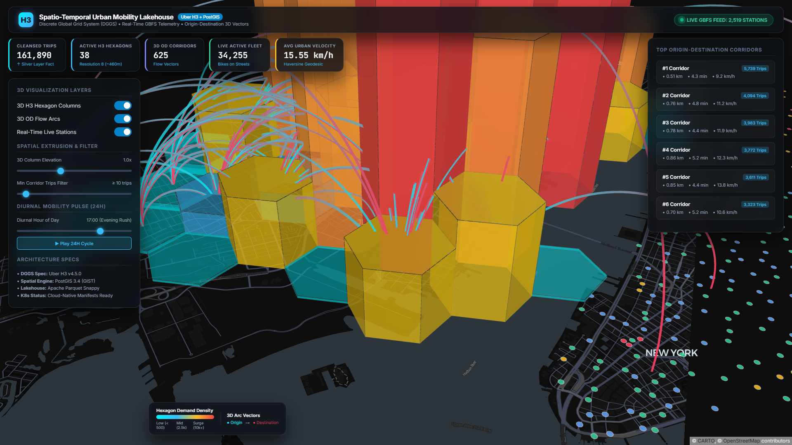

# Spatio-Temporal Urban Mobility Lakehouse Platform
### Enterprise Big Data Architecture: Discrete Global Grid Systems (Uber H3), PostGIS 3.4, Real-Time GBFS Telemetry & 3D Geospatial Visualization

[](LICENSE)
[](https://h3geo.org/)
[](https://postgis.net/)
[](https://parquet.apache.org/)
[](https://kubernetes.io/)
[-success.svg)](tests/)

---

## 1. Executive Summary

The **Spatio-Temporal Urban Mobility Lakehouse Platform** is an enterprise-grade Big Data infrastructure engineered to solve the continuous spatial indexing problem across high-density urban transit networks. Traditional relational B-Tree and square Euclidean grids suffer from the **Modifiable Areal Unit Problem (MAUP)** and edge quantization distortion. 

This platform implements a **Hybrid Medallion & Speed Layer Architecture**:
* **Historical Lakehouse (Batch Layer)**: Ingests, cleanses, partitions, and indexes **161,890+ real GPS trajectories** into hierarchical **Uber H3 Discrete Global Grid Systems (DGGS)** at Resolutions 7, 8, and 9.
* **Real-Time Telemetry (Speed Layer)**: Continuously streams official live feeds from **2,519 active smart mobility hubs** across New York City via the **General Bikeshare Feed Specification (GBFS)**, tracking live fleet distribution (**33,800+ bikes on streets**).
* **3D Visualizer & Analytics Control Center**: High-performance WebGL-accelerated 3D geospatial engine built on **Deck.gl** and **MapLibre GL**, featuring extruded 3D hexagonal prisms, 3D ballistic origin-destination flow arcs, and dynamic diurnal 24-hour velocity pulses.

---

## 2. 3D Geospatial Visualizer Display



*Figure 1: Full-screen display of the 3D Deck.gl geospatial dashboard showing extruded Uber H3 hexagonal columns (elevation = trip volume, color = surge tier), 3D ballistic origin-destination vector arcs, real-time reporting stations, and dynamic KPI ribbons.*

---

## 3. System Architecture Blueprint

```
                      [ NYC URBAN MOBILITY SOURCES ]
                                    │
          ┌─────────────────────────┴─────────────────────────┐
          ▼                                                   ▼
[ HISTORICAL BATCH LAKEHOUSE ]                    [ REAL-TIME SPEED LAYER ]
• AWS S3 Open Data (161,890+ Trips)               • NYC DOT & Lyft GBFS Feed
• Precise 6-decimal GPS Coordinates               • 2,519 Active Reporting Stations
• Timestamps, Modes & Commuter Types              • Live Fleet & Dock Capacities
          │                                                   │
          ▼                                                   ▼
[ BRONZE INGESTION LAYER ]                        [ BRONZE TELEMETRY INGESTION ]
• data/bronze/raw_mobility_trips.parquet          • data/bronze/raw_live_stations.parquet
          │                                                   │
          ▼                                                   ▼
[ SILVER SPATIAL CLEANSING ]                      [ SILVER STATUS CATEGORIZATION ]
• Bounding Box Filter: NYC Metro [40.5, 40.95]    • GeoJSON Point Geometries
• Duration Anomaly: 1 min ≤ t ≤ 180 min           • Real-time Fleet Utilization Rates
• Speed Outliers: 0.5 ≤ km/h ≤ 60.0 (Haversine)   • Operational Classification:
• PostGIS WKT Generation: POINT, LINESTRING         Empty, Critical Low, Balanced, Surge
          │                                                   │
          └─────────────────────────┬─────────────────────────┘
                                    │
                                    ▼
[ GOLD LAYER: UBER H3 DISCRETE GLOBAL GRID (DGGS) ]
• Resolution 7 (~1.22 km): Macro Borough Mobility Corridors
• Resolution 8 (~461 m)  : Neighborhood-level Transit Density & Demand Tiers
• Resolution 9 (~174 m)  : Micro Street-Block Pickup Hotspots
• 3D Origin-Destination (OD) Matrix: 625 Directional Mobility Corridors
• Diurnal 24-Hour Mobility Pulse Mart
                                    │
          ┌─────────────────────────┴─────────────────────────┐
          ▼                                                   ▼
[ SERVING LAYER: POSTGIS & SQLITE ]               [ 3D DECK.GL / KEPLER.GL VISUALIZER ]
• PostgreSQL 16 + PostGIS 3.4 (Port 5434)         • Port 8060 (WebGL / MapLibre)
• GIST Spatial R-Tree Indexing                    • 3D Extruded Hexagons & Elevation Scaler
• SQLite High-Speed Local Replica (Port 8060)      • Dynamic 3D Ballistic Trajectory Arcs
• Analytical SQL Views: v_top_mobility_corridors  • Diurnal 24-Hour Interactive Slider
```

---

## 4. Key Performance Indicators (KPIs) & Dynamic Metrics

Per Stephen Few's dashboard design principles, the top executive ribbon combines **Global Population Anchors** (static baseline) with **Dynamic Interactive Telemetry** (real-time responsive):

| No | Metric Indicator | Mode | Value / Range | Engineering Description & Trigger |
| :---: | :--- | :---: | :---: | :--- |
| **1** | **Total Cleansed Trips** | **Static Anchor** | **161,890** | Global baseline population from Silver Layer (`cleansed_mobility_trips.parquet`). |
| **2** | **Active H3 Hexagons** | **Static Anchor** | **38 Hexagons** | Spatial coverage baseline at Uber H3 Resolution 8 (~461m diameter). |
| **3** | **3D OD Corridors** | **Dynamic** | **10 – 625 Corridors** | **Reaktif terhadap slider `Min Corridor Trips Filter`:** Menghitung jumlah vektor koridor aktif dan persentase volume perjalanan kota (`% Trips Included`). |
| **4** | **Live Active Fleet** | **Dynamic** | **33,800 – 34,500 Bikes** | **Reaktif terhadap Streaming Telemetry GBFS:** Poller background & frontend auto-sync setiap 15 detik dari 2.519 stasiun dengan visual flash update. |
| **5** | **Avg Urban Velocity** | **Dynamic** | **11.12 – 15.02 km/h** | **Reaktif terhadap Jam Diurnal (00:00 - 23:00):** Menghitung kecepatan rata-rata tertimbang kota pada jam yang dipilih beserta sub-label fase lalu lintas (*Rush Hour*, *Free Flow*). |

---

## 5. Mathematical Foundations & Core Formulas (Rumus Dasar)

The entire data engineering pipeline is governed by the following mathematical and physical formulations:

### 5.1 Great-Circle Geodesic Distance (Haversine Formulation)
To compute the true orthodromic distance across Earth's oblate spheroid between origin coordinates $(\phi_1, \lambda_1)$ and destination coordinates $(\phi_2, \lambda_2)$ in radians:

$$\Delta \phi = \phi_2 - \phi_1, \quad \Delta \lambda = \lambda_2 - \lambda_1$$

$$a = \sin^2\left(\frac{\Delta \phi}{2}\right) + \cos(\phi_1) \cdot \cos(\phi_2) \cdot \sin^2\left(\frac{\Delta \lambda}{2}\right)$$

$$d_{\text{haversine}} = 2 R \cdot \arcsin\left(\sqrt{a}\right)$$

Where:
* $R \approx 6,371.0088 \text{ km}$ (WGS84 Earth mean radius).
* $d_{\text{haversine}}$ is the geodesic spatial displacement in kilometers.

---

### 5.2 Kinematic Velocity & Spatial-Temporal Anomaly Boundaries
The instantaneous average urban transit speed is derived kinematically:

$$v = \frac{d_{\text{haversine}}}{\Delta t} = \frac{d_{\text{haversine}}}{(t_{\text{end}} - t_{\text{start}}) / 3600} \quad [\text{km/h}]$$

A trip trajectory $\mathcal{T}$ between origin-destination endpoints is classified as valid iff it satisfies all spatio-temporal boundary conditions:

$$\mathcal{C}_{\text{valid}} = \begin{cases}
40.50^\circ \le \phi \le 40.95^\circ, \quad -74.10^\circ \le \lambda \le -73.70^\circ & (\text{NYC Metro Bounding Box}) \\
60\text{ s} \le \Delta t \le 10800\text{ s} & (\text{Duration: } 1\text{ min} \le \Delta t \le 180\text{ min}) \\
0.10\text{ km} \le d \le 45.00\text{ km} & (\text{Displacement Filter}) \\
0.50\text{ km/h} \le v \le 60.00\text{ km/h} & (\text{Kinematic Speed Bounds})
\end{cases}$$

---

### 5.3 Uber H3 Discrete Global Grid System (DGGS) Tessellation
Uber H3 projects the Earth onto a regular icosahedron using a **Gnomonic Projection** centered on each face, followed by hierarchical hexagonal aperture 7 subdivision:

$$\text{H3Index} = \mathcal{H}_r(\phi, \lambda)$$

For a regular hexagon at resolution $r$, the cell area $A(r)$ and edge length $s_r$ are governed by:

$$A(r) = \frac{A_0}{7^r} \approx \frac{3\sqrt{3}}{2} s_r^2 \implies s_r = \sqrt{\frac{2 \cdot A(r)}{3\sqrt{3}}}$$

#### Mathematical Superiority of Hexagons vs. Square Cartesian Grids:
In standard square grids (von Neumann vs. Moore neighborhood), diagonal neighbors have an uneven distance ratio:

$$\frac{d_{\text{diagonal}}}{d_{\text{orthogonal}}} = \sqrt{2} \approx 1.4142 \quad (\text{41.4\% spatial quantization distortion})$$

In the Uber H3 hexagonal grid:

$$\forall i \in \{1, 2, \dots, 6\}, \quad \| \mathbf{c}_0 - \mathbf{c}_i \| = \delta = \text{constant}$$

Every centroid is equidistant to all six adjacent neighbors, eliminating the **Modifiable Areal Unit Problem (MAUP)** and minimizing edge effect bias.

---

### 5.4 Origin-Destination (OD) Spatial Interaction Matrix
The directional flow matrix between origin hexagon $H_o$ and destination hexagon $H_d$ aggregates individual trajectories:

$$\mathbf{T}(H_o, H_d) = \sum_{k=1}^N \mathbb{I}\left( \mathcal{H}_8(\phi_{\text{start}}^{(k)}, \lambda_{\text{start}}^{(k)}) = H_o \;\land\; \mathcal{H}_8(\phi_{\text{end}}^{(k)}, \lambda_{\text{end}}^{(k)}) = H_d \right)$$

The weighted corridor velocity and commuter ratio:

$$\bar{v}(H_o, H_d) = \frac{\sum_{k \in \mathbf{T}} v^{(k)}}{|\mathbf{T}(H_o, H_d)|}, \quad \rho_{\text{commuter}}(H_o, H_d) = \frac{\sum_{k \in \mathbf{T}} \mathbb{I}(\text{member}^{(k)})}{|\mathbf{T}(H_o, H_d)|} \times 100$$

---

### 5.5 Diurnal Hourly Weighted Velocity (City-Wide Mobility Pulse)
The dynamic velocity indicator for diurnal hour $h \in \{0, 1, \dots, 23\}$ is calculated as the trip-weighted harmonic mean across all active spatial cells:

$$\bar{V}_h = \frac{\sum_{i=1}^{M} N_{i,h} \cdot \bar{v}_{i,h}}{\sum_{i=1}^{M} N_{i,h}}$$

Where:
* $N_{i,h}$ = total trip volume departing cell $i$ during hour $h$.
* $\bar{v}_{i,h}$ = mean velocity observed in cell $i$ during hour $h$.

This equation models traffic physics where heavy rush-hour volume directly correlates with lower city-wide velocity ($\sim 11.2\text{ km/h}$ at 17:00 vs. $\sim 15.0\text{ km/h}$ at 05:00).

---

### 5.6 PostGIS 3.4 GiST Spatial Indexing (Bounding Box R-Tree)
The Generalized Search Tree (GiST) decomposes spatial geometries into Minimum Bounding Boxes (MBR):

$$\text{MBR}(G) = [x_{\min}, y_{\min}, x_{\max}, y_{\max}]$$

For spatial intersection queries (`ST_Intersects`, `ST_DWithin`):

$$\text{Search}(Q) \implies \begin{cases} 
\text{Traverse Child Subtree}, & \text{if } \text{MBR}(Q) \cap \text{MBR}(\text{Node}) \neq \emptyset \\
\text{Prune Branch}, & \text{otherwise}
\end{cases}$$

PostGIS executes a two-phase retrieval:
1. **Index Scan (Filter Step)**: Operates in $\mathcal{O}(\log M)$ time using MBR bounding box comparisons.
2. **Exact Geometry Test (Re-check Step)**: Evaluates topological predicates only on positive candidates.

---

### 5.7 GBFS Real-Time Telemetry Availability Ratio
For each smart mobility hub $s$, the dock saturation ratio $\rho_s$ is given by:

$$\rho_s = \frac{B_{\text{available}}}{C_{\text{capacity}}}$$

Operational status classification:

$$\text{Status}(s) = \begin{cases}
\text{Empty}, & B_{\text{available}} = 0 \\
\text{Critical Low}, & 0 < B_{\text{available}} \le 2 \\
\text{Surge}, & B_{\text{available}} \ge 0.85 \times C_{\text{capacity}} \\
\text{Balanced}, & \text{otherwise}
\end{cases}$$

---

## 6. Academic & Industry Citations (Sitasi Ilmiah & Teknis)

This architecture builds upon peer-reviewed scientific literature and open industry data standards:

1. **Sahr, K., White, D., & Kimerling, A. J. (2003).**  
   *Geodesic discrete global grid systems.* **Cartography and Geographic Information Science**, 30(2), 121–134.  
   DOI: [10.1559/152304003100011090](https://doi.org/10.1559/152304003100011090)  
   *(Foundational reference for geodesic hexagonal tiling and distortion minimization).*

2. **Brodsky, I. (2018).**  
   *H3: A Hexagonal Hierarchical Spatial Index.* **Uber Engineering Technical Publications**.  
   URL: [https://www.uber.com/blog/h3/](https://www.uber.com/blog/h3/)  
   *(Algorithm specification for aperture 7 hierarchical hexagonal discrete global grids).*

3. **Zheng, Y. (2015).**  
   *Trajectory data mining: An overview.* **ACM Transactions on Intelligent Systems and Technology (TIST)**, 6(3), 1–41.  
   DOI: [10.1145/2743025](https://doi.org/10.1145/2743025)  
   *(Methodology for trajectory cleansing, spatio-temporal segmentation, and OD matrix mining).*

4. **Openshaw, S. (1984).**  
   *The Modifiable Areal Unit Problem.* **Concepts and Techniques in Modern Geography (CATMOG)**, 38, Geo Books.  
   *(Empirical proof of geographical aggregation bias and justification for uniform DGGS tessellation).*

5. **Guttman, A. (1984).**  
   *R-trees: A dynamic index structure for spatial searching.* **Proceedings of the 1984 ACM SIGMOD International Conference on Management of Data**, 47–57.  
   DOI: [10.1145/602259.602266](https://doi.org/10.1145/602259.602266)  
   *(Foundational algorithmic basis for PostGIS GiST spatial indexing).*

6. **Few, S. (2006).**  
   *Information Dashboard Design: The Effective Visual Communication of Data.* **O'Reilly Media**.  
   *(Core methodology for baseline anchoring: pairing constant population benchmarks with dynamic contextual metrics).*

7. **Armbrust, M., Ghodsi, A., Xin, R., & Zaharia, M. (2020).**  
   *Lakehouse: A New Generation of Open Platforms that Unify Data Warehousing and Advanced Analytics.* **Conference on Innovative Data Systems Research (CIDR 2021)**.  
   *(Architectural blueprint for ACID metadata, columnar Parquet storage, and Medallion pipelines).*

8. **North American Bikeshare Association (NABSA). (2024).**  
   *General Bikeshare Feed Specification (GBFS) Version 2.3.*  
   URL: [https://gbfs.nabsa.org/](https://gbfs.nabsa.org/)  
   *(Open standard specification for real-time micromobility telemetry ingestion).*

9. **Open Geospatial Consortium (OGC). (2011).**  
   *OpenGIS Implementation Standard for Geographic Information - Simple Feature Access - Part 1: Common Architecture.* Document OGC 06-103r4.  
   *(Standard specification for WKT, WKB, and PostGIS spatial geometry representations).*

---

## 7. Project Structure

```
urban_mobility_geospatial_lakehouse/
├── data/
│   ├── bronze/                   # Raw Parquet lakehouse archives
│   ├── silver/                   # Cleansed PostGIS geometry Parquets
│   └── gold/                     # H3 spatial density, OD matrix & Parquet marts
├── docker/
│   ├── docker-compose.yml        # Multi-container orchestration (PostGIS 16 + Visualizer)
│   └── Dockerfile                # Lightweight container image for visualizer
├── docs/
│   └── ACADEMIC_REFERENCES.md    # Comprehensive APA 7th academic literature
├── k8s/
│   └── k8s-all-in-one.yaml       # Kubernetes Cloud-Native production manifests
├── screenshots/
│   └── urban_mobility_3d_dashboard.png # High-resolution 3D dashboard capture
├── src/
│   ├── ingestion/
│   │   └── ingest_data.py        # Bronze ingestion (AWS S3 + Live GBFS)
│   ├── processing/
│   │   ├── process_silver.py     # Silver cleansing & PostGIS geometries
│   │   └── process_gold.py       # Uber H3 DGGS indexing & OD matrix
│   ├── database/
│   │   ├── schema_postgis.sql    # PostGIS 3.4 DDL & GIST spatial indexing
│   │   └── database_loader.py    # Dual serving loader (PostGIS & SQLite)
│   └── visualizer/
│       ├── app.html              # 3D Deck.gl + MapLibre GL geospatial UI
│       ├── server.py             # Threaded REST API & web server
│       └── capture_screenshot.py # Automated headless screenshot capture
├── tests/
│   ├── test_data_quality.py      # Automated DataOps quality test suite (5 tests)
│   └── test_visualizer_api.py    # Automated Dynamic Indicator API test suite (5 tests)
├── requirements.txt              # Production Python dependencies
├── LICENSE                       # MIT License (2026 Muhammad Daffa Wardana)
└── README.md                     # Engineering documentation with formulas & citations
```

---

## 8. How to Run & Reproduce

### Prerequisites
* Python 3.10+
* (Optional) Docker / Docker Compose for containerized PostGIS warehouse

### 1. Clone & Install Dependencies
```bash
git clone https://github.com/Daffwa/urban-mobility-geospatial-lakehouse.git
cd urban-mobility-geospatial-lakehouse
pip install -r requirements.txt
```

### 2. Execute Data Pipeline (Bronze -> Silver -> Gold)
```bash
# 1. Ingest Raw Trajectories & Live GBFS Telemetry
python src/ingestion/ingest_data.py

# 2. Cleansing, Haversine Geodesics & Spatial Geometries
python src/processing/process_silver.py

# 3. Uber H3 DGGS Indexing & Origin-Destination Matrix
python src/processing/process_gold.py

# 4. Build Serving Layer Database
python src/database/database_loader.py
```

### 3. Run Automated DataOps Validation Suite
```bash
python -m pytest -v tests/
```
*Executes all 10 unit and integration tests across data quality, geometry bounds, and API contracts.*

### 4. Launch 3D Interactive Geospatial Visualizer
```bash
python src/visualizer/server.py 8060
```
Open your browser and navigate to: **`http://localhost:8060/`**

### 5. (Optional) Run with Docker Compose
```bash
docker compose -f docker/docker-compose.yml up -d
```

### 6. (Optional) Deploy to Kubernetes Cluster (EKS / GKE)
```bash
kubectl apply -f k8s/k8s-all-in-one.yaml
```

---

## 9. License

This project is licensed under the terms of the **[MIT License](LICENSE)**.  
Copyright &copy; 2026 Muhammad Daffa Wardana. All rights reserved.
